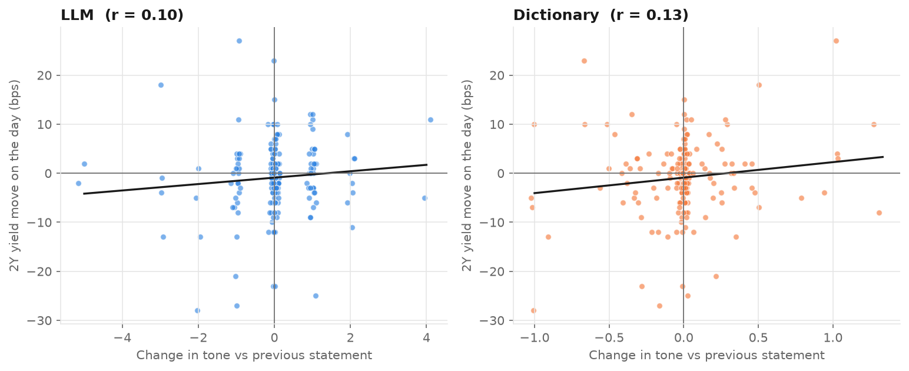
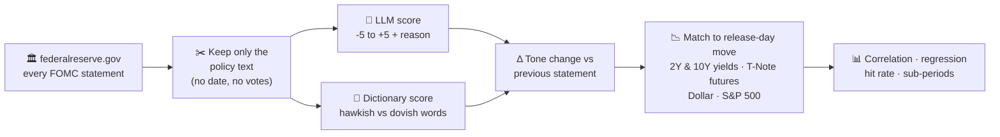
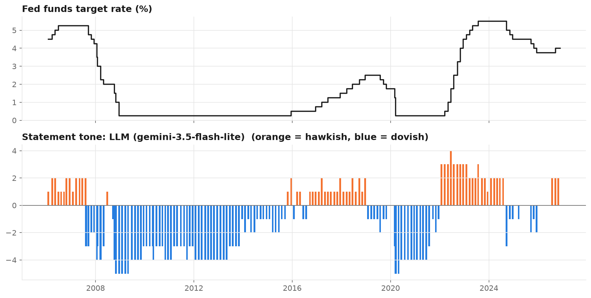
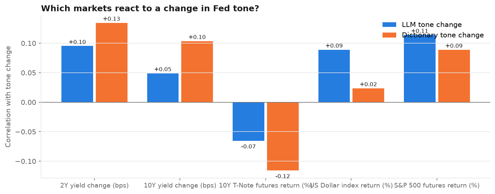
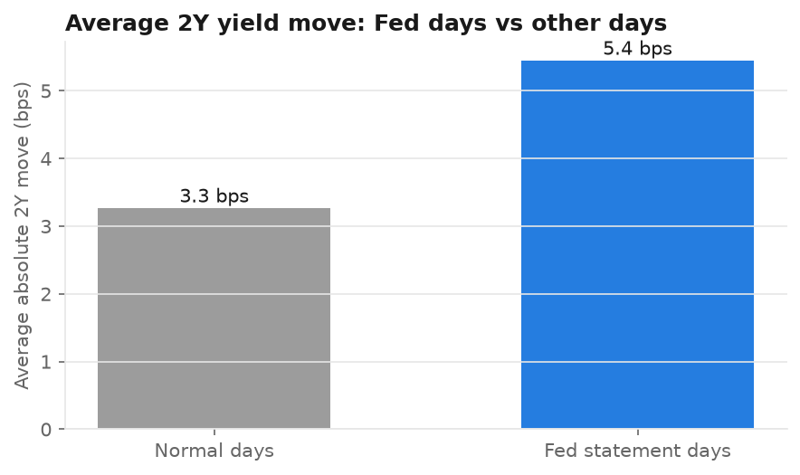

<div align="center">

# 🏛️ Fed Tone vs. Market Reaction

**Scoring every FOMC statement since 2006 as hawkish or dovish with an LLM, and testing whether the change in tone moves Treasury yields, bond futures, the dollar and stocks**


</div>

---

## ⚡ At a glance

> **Question:** When the Federal Reserve's statement sounds more hawkish than last time, do markets react the way theory says: higher yields, lower bond futures, a stronger dollar?
>
> **Approach:** Score each statement's tone two ways, with an **LLM** and with a transparent **word-count dictionary**, then measure each market's move on the release day.

<!-- RESULTS:START (auto-generated by run_analysis.py, do not edit by hand) -->
*176 FOMC statements, 2006-01-31 to 2026-10-28. Market reaction = close-to-close move on the release day.*

|                                           | LLM tone change   | Dictionary tone change   |
|:------------------------------------------|:------------------|:-------------------------|
| Correlation: tone change vs 2Y yield move | +0.10             | +0.13                    |
| Direction hit rate (2Y yield)             | 56% of 72         | 51% of 79                |
| 2Y move per 1-sd tone change              | +0.8 bps          | +1.1 bps                 |
| t-stat (robust)                           | +1.25             | +1.22                    |
| R²: rate decision only → + tone           | 0.00 → 0.01       | 0.00 → 0.02              |

Fed statement days move the 2Y yield **5.4 bps** on average, vs **3.3 bps** on other days.
<!-- RESULTS:END -->



### 🔍 Key findings

- **Fed days matter.** The 2Y yield moves **5.4 bps** on statement days vs **3.3 bps** on other days, about 60% more.
- **But statement tone alone explains little of the daily move.** The correlation between tone change and the 2Y move is only **+0.10 (LLM)** and **+0.13 (dictionary)**, and it isn't statistically significant. Markets price in most of the message before 2 p.m.; the real surprise is relative to *expectations*, not to the previous statement.
- **The rate decision itself explains almost nothing** (R² ≈ 0.00). Hikes and cuts are nearly always priced in before 2 p.m.; markets move on what is *new*, which is why measuring the surprise matters more than measuring the decision.
- **The LLM did not beat simple word counting** at daily frequency. The two methods largely agree on tone (correlation 0.76).
- **Change beats level.** Tone *level* has essentially no link to the move (−0.04); tone *change* is positive for both methods, consistent with markets reacting to news.
- **Strongest in 2009–2015** (correlation 0.25–0.30). With rates stuck at zero, the statement's wording (forward guidance) *was* the policy tool, so words mattered more.

**What the biggest moves reveal:**

| Date | 2Y move | What happened |
|:--|:--:|:--|
| 18-Mar-2009 | −23 bps | QE announced, but the LLM tone was already at −5 (the bottom of the scale), so the measured *change* was 0. **The scale saturated.** |
| 13-Dec-2023 | −27 bps | The statement was almost unchanged; the dovish signal came from the Fed's projections and press conference, which this project doesn't score. |
| 18-Mar-2008 | +23 bps | A 75 bp **cut**, yet yields **rose**, consistent with markets having expected an even bigger cut. "Dovish" ≠ "dovish surprise". |
| 15-Jun-2022 | −25 bps | The LLM described the hike as 50 bps; it was actually **75 bps**. LLM reasons need checking. |

**Next step:** score each statement *relative to the previous one* (give the LLM both texts), use fed funds futures to measure expectations, and use intraday windows around 2 p.m.

---

## ⚙️ How it works



1. **Collect:** download every FOMC statement since 2006 from the Federal Reserve's website and keep only the policy language.
2. **Score:** an LLM rates each statement from −5 (very dovish) to +5 (very hawkish) with a one-line reason. A hawkish/dovish word dictionary gives a second, fully transparent score.
3. **Measure surprise:** markets react to *news*, so the signal is the **change** in tone versus the previous statement, not the tone itself.
4. **Measure reaction:** statements come out at 2 p.m. New York time, while markets are open, so the reaction is the close-to-close move on the release day.
5. **Test:** correlations, a regression that controls for the rate decision itself, directional hit rate, and sub-periods (normal rates vs. the 2009-2015 zero lower bound).

### Why the 2-year yield?

The 2Y Treasury yield is the market's best real-time read of where the Fed will set rates over the next two years, so it is the cleanest single gauge of a policy surprise.

---

## 📊 Charts





<p align="center">
  
</p>

Full report with regressions, sub-periods and the 10 biggest market moves (with the LLM's reasoning): [`results/REPORT.md`](results/REPORT.md)

---

## 🛡️ Pitfalls handled

| Pitfall | What this project does |
|:--|:--|
| **LLM hindsight** | LLMs were trained on later news and may "know" what came next. The model only sees the statement text, with no date or headline, and is told to judge wording only. The dictionary method has no such knowledge, which makes it a check. |
| **Level vs. surprise** | Uses the tone **change** versus the previous statement; the report also shows the level for comparison. |
| **Decision vs. words** | The regression controls for the actual rate change, so the tone effect is what the wording adds beyond the decision. |
| **Event timing** | Close-to-close on the release day; weekend emergency statements (e.g. Sunday 15 March 2020) are matched to the next trading day. |
| **Reproducibility** | Every LLM score is cached with its reason, so re-runs give identical results and each statement is sent only once. |

---

## 🚀 Quick start

```bash
git clone https://github.com/sharaddsingh/fed-sentiment-bonds.git
cd fed-sentiment-bonds
pip install -r requirements.txt
```

Set **one** LLM API key (Gemini has a free tier):

```powershell
# Windows PowerShell
$env:GEMINI_API_KEY = "your-key"      # or OPENAI_API_KEY / ANTHROPIC_API_KEY
```
```bash
# Mac / Linux
export GEMINI_API_KEY="your-key"
```

```bash
python run_analysis.py           # downloads statements + market data, scores, analyses
python run_analysis.py --no-llm  # dictionary method only, no API key needed
python -m pytest -q              # tests (offline)
```

<details>
<summary><b>⚠️ Limitations</b></summary>

<br>

- **Daily data is noisy.** A close-to-close move includes everything else that happened that day. Intraday data (e.g. 30 minutes around 2 p.m.) would isolate the Fed's effect better but isn't free.
- **No expectations data.** The true surprise is the statement versus what markets *expected*. The previous statement is a simple proxy; fed funds futures would be better.
- **Press conferences.** Since 2011 the Chair speaks 30 minutes after the statement, and that also moves markets on the same day.
- **LLM hindsight can't be fully ruled out.** Numbers inside the text (e.g. the target range) can hint at the period.
- **Single model, single prompt.** Scores could shift with a different model or wording.

</details>

<details>
<summary><b>🔭 Possible extensions</b></summary>

<br>

- Score FOMC **minutes** and **press-conference transcripts** as well
- Use fed funds futures to measure the true policy surprise
- Compare several LLMs and prompts for stability
- Use the tone change as a trading signal for Treasury futures (with out-of-sample testing)

</details>

<details>
<summary><b>📁 Project structure</b></summary>

<br>

```
config.py              settings, LLM providers and model names
run_analysis.py        runs the full pipeline and writes results/
src/fed_statements.py  find, download and clean FOMC statements
src/market_data.py     FRED yields + Fed funds target, Yahoo futures prices
src/dictionary.py      hawkish / dovish word-count score
src/llm_scorer.py      LLM scoring (Gemini / OpenAI / Claude), caching, retries
src/events.py          align statements with market moves, tone changes
src/analysis.py        correlations, regression, hit rate, sub-periods
src/plots.py           charts
src/synthetic.py       fake data for the offline demo and tests
tests/                 parsing, timing, caching and scoring tests
```

</details>

---

### 📚 References

- Gürkaynak, Sack & Swanson (2005). *Do Actions Speak Louder Than Words? The Response of Asset Prices to Monetary Policy Actions and Statements.* International Journal of Central Banking.
- Lucca & Trebbi (2009). *Measuring Central Bank Communication: An Automated Approach with Application to FOMC Statements.* NBER Working Paper.
- Hansen & McMahon (2016). *Shocking Language: Understanding the Macroeconomic Effects of Central Bank Communication.* Journal of International Economics.

<div align="center">

**Sharad Pratap Singh** · *Research project for learning purposes. Not investment advice.*

</div>
