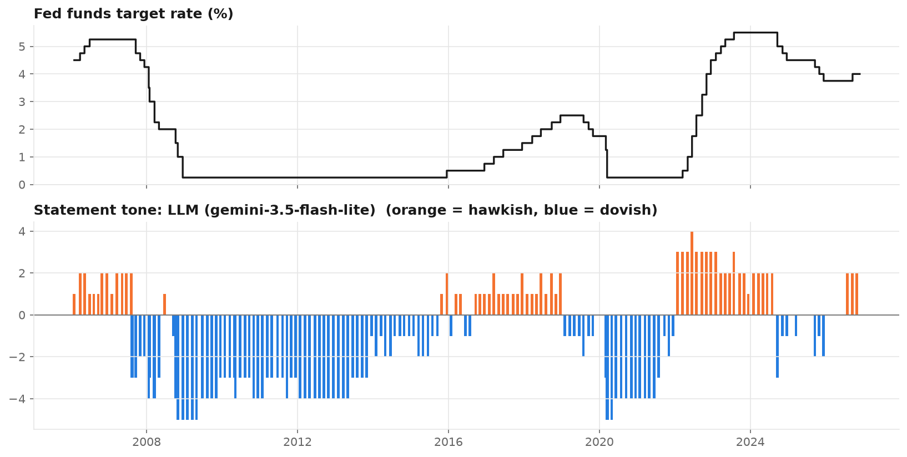
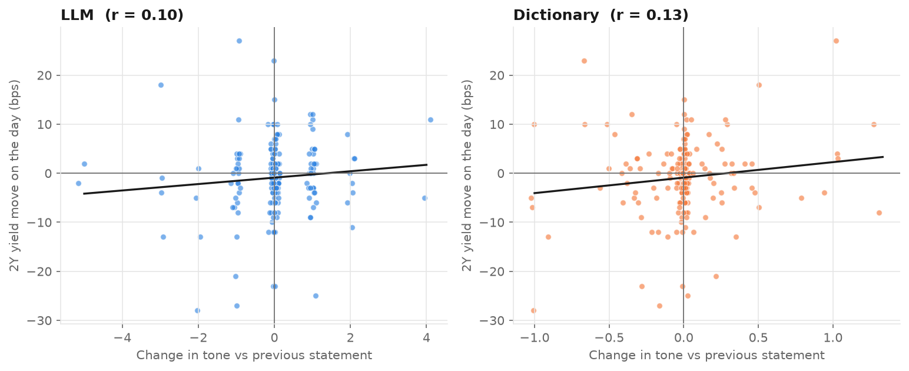
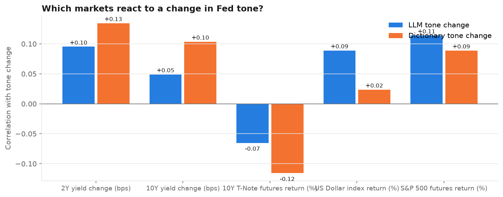
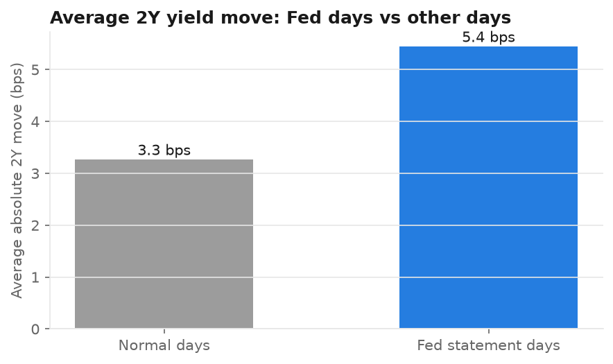

# Fed tone vs. market reaction: report

**176 FOMC statements, 2006-01-31 to 2026-10-28.** Tone scored by LLM (gemini-3.5-flash-lite) and a hawkish/dovish word dictionary.

## Headline

|                                           | LLM tone change   | Dictionary tone change   |
|:------------------------------------------|:------------------|:-------------------------|
| Correlation: tone change vs 2Y yield move | +0.10             | +0.13                    |
| Direction hit rate (2Y yield)             | 56% of 72         | 51% of 79                |
| 2Y move per 1-sd tone change              | +0.8 bps          | +1.1 bps                 |
| t-stat (robust)                           | +1.25             | +1.22                    |
| R²: rate decision only → + tone           | 0.00 → 0.01       | 0.00 → 0.02              |

- Fed statement days: average |2Y move| **5.4 bps** vs **3.3 bps** on other days.
- Agreement between LLM and dictionary tone levels: correlation **0.76**.

## Correlation of tone change with each market

|                        |   2Y yield change (bps) |   10Y yield change (bps) |   10Y T-Note futures return (%) |   US Dollar index return (%) |   S&P 500 futures return (%) |
|:-----------------------|------------------------:|-------------------------:|--------------------------------:|-----------------------------:|-----------------------------:|
| LLM tone change        |                    0.1  |                     0.05 |                           -0.07 |                         0.09 |                         0.11 |
| Dictionary tone change |                    0.13 |                     0.1  |                           -0.12 |                         0.02 |                         0.09 |

Expected signs for a hawkish surprise: yields up (+), T-Note futures down (-), dollar up (+), stocks down (-).

## Tone level vs. tone change

Correlation with the 2Y yield move:

|                        |   corr |
|:-----------------------|-------:|
| LLM tone level         |  -0.04 |
| Dictionary tone level  |  -0.04 |
| LLM tone change        |   0.1  |
| Dictionary tone change |   0.13 |

## Regression: 2Y move = a + b·tone change (standardised) + c·rate change

|                        |   Tone effect (bps per 1 sd) |   t-stat |   p-value |   Rate-change effect (bps per 1 bp) |   R² (tone + rate) |   R² (rate only) |   N |
|:-----------------------|-----------------------------:|---------:|----------:|------------------------------------:|-------------------:|-----------------:|----:|
| LLM tone change        |                        0.765 |    1.249 |     0.211 |                              -0.004 |              0.009 |                0 | 175 |
| Dictionary tone change |                        1.061 |    1.225 |     0.221 |                              -0.004 |              0.018 |                0 | 175 |

## Sub-periods (correlation of tone change with 2Y move)

|                              |   LLM tone change |   Dictionary tone change |   Statements |
|:-----------------------------|------------------:|-------------------------:|-------------:|
| 2006-2008 (normal rates)     |             -0.04 |                     0.15 |           28 |
| 2009-2015 (zero lower bound) |              0.25 |                     0.3  |           57 |
| 2016-today (normal rates)    |              0.16 |                     0.09 |           91 |

## 10 biggest 2Y yield moves on statement days

| date       |   d2y_bps |   rate_change_bps |   dict_score |   d_dict |   llm_score |   d_llm | llm_reason                                                                                                                                                                                     |
|:-----------|----------:|------------------:|-------------:|---------:|------------:|--------:|:-----------------------------------------------------------------------------------------------------------------------------------------------------------------------------------------------|
| 2008-01-22 |       -28 |               -75 |        -1    |    -1    |          -4 |      -2 | A large 75 basis point rate cut combined with concerns over a weakening economic outlook and downside risks indicates a strongly dovish policy stance.                                         |
| 2023-12-13 |       -27 |                 0 |         0.67 |    -0.17 |           1 |      -1 | The statement maintains high rates and leaves the door open for additional policy firming while acknowledging that inflation remains elevated.                                                 |
| 2008-03-11 |        27 |                 0 |         0    |     1    |          -4 |      -1 | The statement announces aggressive emergency liquidity facilities, including a $200 billion securities lending program and expanded swap lines to address severe funding pressures.            |
| 2022-06-15 |       -25 |                75 |         1    |     0    |           4 |       1 | The statement announces a 50-basis-point rate hike, continued balance sheet reduction, and emphasizes strong commitment to combating elevated inflation.                                       |
| 2009-03-18 |       -23 |                 0 |        -1    |    -0.29 |          -5 |       0 | The statement announces zero interest rates, aggressive quantitative easing with massive asset purchases, and a commitment to use all available tools to combat a severe economic contraction. |
| 2008-03-18 |        23 |               -75 |        -0.67 |    -0.67 |          -4 |       0 | A aggressive 75 basis point rate cut combined with acknowledgment of a severely weakened economic outlook reflects a strongly dovish monetary policy stance.                                   |
| 2007-12-11 |       -23 |               -25 |         0    |     0    |          -2 |       0 | The Committee lowered the federal funds rate by 25 basis points in response to slowing growth and financial market strains, reflecting an easing bias.                                         |
| 2023-03-22 |       -21 |                25 |         1    |     0.22 |           2 |      -1 | The statement announces a rate hike and anticipates additional policy firming due to elevated inflation, while acknowledging tighter credit conditions.                                        |
| 2008-10-08 |        18 |               -50 |         0    |     0.5  |          -4 |      -3 | The statement announces a coordinated 50 basis point rate cut alongside other global central banks to combat severe financial turmoil and slowing economic activity.                           |
| 2026-06-17 |        15 |                 0 |         1    |     0    |           0 |       0 | The statement maintains the current rate, acknowledges solid growth and elevated inflation, and expresses a balanced stance without signaling imminent easing or tightening.                   |

## Charts

